# GAN 

## 1. GAN구조

① GAN — 생성자와 판별자가 경쟁하면서 실제 데이터와 유사한 데이터를 생성하는 방법이다.

## 2. 핵심 차이 비교

| 구분      | GAN                      | 
| ------- | ------------------------ | 
| 주요 목적   | 실제와 유사한 데이터 생성           | 
| 학습 방식   | 생성자와 판별자의 적대적 학습         | 
| 주요 구성   | Generator, Discriminator | 
| 피드백     | 판별자의 출력과 손실함수            | 
| 학습 대상   | 데이터 생성 분포                | 
| 대표 알고리즘 | DCGAN, WGAN, StyleGAN    |
| 활용 분야   | 이미지 생성, 데이터 증강           | 
## 3. GAN의 학습 과정

예를 들어 GAN으로 사람 얼굴 이미지를 생성한다고 가정한다.

1. Generator가 무작위 노이즈를 입력받아 가짜 얼굴을 생성한다.
2. Discriminator가 실제 얼굴과 생성된 얼굴을 구분한다.
3. Discriminator는 진짜와 가짜를 더 잘 구분하도록 학습한다.
4. Generator는 Discriminator를 속일 수 있도록 학습한다.
5. 이러한 경쟁을 반복하면서 생성 이미지의 품질을 개선한다.

GAN의 기본 목적함수는 다음과 같다.

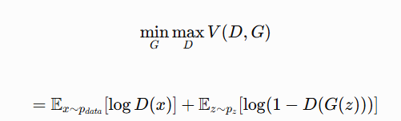

여기서 (G)는 생성자, (D)는 판별자이다.

### (1) GAN 목적함수
Genertor(생성자)와 Discriminator(판별자)가 서로 반대되는 목표를 가지고 경쟁하면서 학습하는 과정을 수학적으로 표현한 것이다.

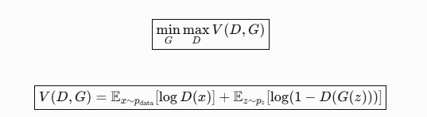

여기서 가장 중요한 부분은 다음과 같다.

- (min_G): Generator는 목적함수 값을 최소화하려고 한다.
- (\max_D): Discriminator는 목적함수 값을 최대화하려고 한다.
- (V(D,G)): 두 모델의 경쟁 관계를 나타내는 목적함수이다.

즉, Discriminator는 진짜와 가짜를 정확히 구별하려고 하고, Generator는 가짜를 진짜처럼 만들어 Discriminator를 속이려고 한다.

### (2) 수식에 등장하는 기호

| 기호                     | 의미                             |
| ---------------------- | ------------------------------ |
| (G)                | Generator, 가짜 이미지를 생성하는 신경망    |
| (D)                | Discriminator, 진짜·가짜를 판별하는 신경망 |
| (x)                | 실제 데이터, 예: MNIST 실제 숫자 이미지     |
| (p_{\text{data}}) | 실제 데이터의 확률분포                   |
| (z)                | 무작위 노이즈 벡터                     |
| (p_z)              | 노이즈의 확률분포, 일반적으로 정규분포          |
| (G(z))             | Generator가 생성한 가짜 이미지          |
| (D(x))             | 실제 이미지가 진짜일 것으로 판별한 확률         |
| (D(G(z)))          | 생성 이미지가 진짜일 것으로 판별한 확률         |
| (\mathbb{E})       | 기댓값, 여러 샘플에 대한 평균              |
| (\log)             | 자연로그                           |

여기서 (D(x))와 (D(G(z)))는 수학적 정의상 0과 1 사이의 확률이다. 앞서 작성한 PyTorch 코드에서는 `Sigmoid`를 명시적으로 사용하지 않았으므로 `D(...)`가 반환하는 값은 확률이 아니라 logit이다. `BCEWithLogitsLoss`가 내부적으로 Sigmoid와 손실 계산을 처리한다.

### (3) 첫 번째 항: 실제 이미지에 대한 판별

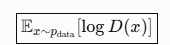

이 항은 Discriminator가 실제 이미지를 진짜라고 판단하도록 학습하는 부분이다.

예를 들어 실제 MNIST 숫자 이미지 (x)를 입력했다고 가정한다.

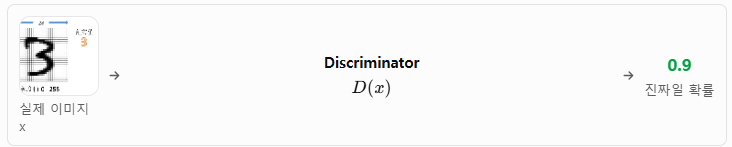

판별 결과에 따른 로그값은 다음과 같다.

| (D(x)) | (log D(x)) | 해석                |
| ---------- | --------------- | ----------------- |
| 0.1        | -2.303          | 실제 이미지를 가짜로 잘못 판단 |
| 0.5        | -0.693          | 진짜·가짜를 구별하지 못함    |
| 0.9        | -0.105          | 실제 이미지를 진짜로 판단    |
| 1.0        | 0               | 가장 이상적인 판별        |

Discriminator는 이 값을 최대화하려고 하므로 \\(D(x)\\)가 1에 가까워지도록 학습한다.

### (4) 두 번째 항: 가짜 이미지에 대한 판별

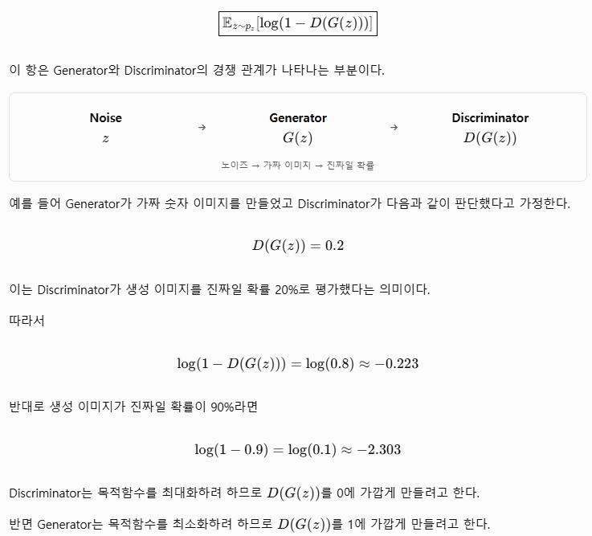

### (5) Generator와 Discriminator의 학습 목표 비교

| 구분                   | Discriminator | Generator   |
| -------------------- | ------------- | ----------- |
| 목적                   | 진짜·가짜 정확히 판별  | 가짜를 진짜처럼 생성 |
| 실제 이미지 (D(x))    | 1에 가깝게        | 직접 제어하지 않음  |
| 가짜 이미지 (D(G(z))) | 0에 가깝게        | 1에 가깝게      |
| 원래 목적함수              | 최대화           | 최소화         |
| 학습 대상                | D의 가중치        | G의 가중치      |

GAN은 이렇게 서로 상반되는 목표를 가진 두 모델을 번갈아 학습시킨다.

### (6) PyTorch 코드와 수식 연결

앞서 작성한 GAN 코드에서 다음 부분이 Discriminator 학습에 해당한다.

```python
# 실제 이미지에 대한 판별 결과
real_outputs = D(real_images)

# 실제 이미지가 진짜(1)가 되도록 학습
d_real_loss = criterion(real_outputs, real_labels)

# 가짜 이미지에 대한 판별 결과
fake_outputs = D(fake_images.detach())

# 가짜 이미지가 가짜(0)가 되도록 학습
d_fake_loss = criterion(fake_outputs, fake_labels)

# 전체 Discriminator 손실
d_loss = d_real_loss + d_fake_loss
```

수학적으로는 다음과 대응된다.

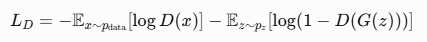

원래 수식에서는 Discriminator가 (V(D,G))를 최대화하지만, PyTorch의 옵티마이저는 일반적으로 손실을 최소화하도록 구현되어 있으므로 음수를 붙여 계산한다.

### Generator의 손실은 왜 다른가?

앞서 작성한 Generator 학습 코드는 다음과 같다.

```python

# Generator가 생성한 이미지에 대한 판별 결과
fake_outputs = D(fake_images)

# 가짜 이미지가 진짜(1)로 판별되도록 학습
g_loss = criterion(fake_outputs, real_labels)
```

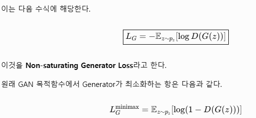

하지만 이 방식은 Discriminator가 가짜 이미지를 매우 잘 판별하는 상황에서 Generator에 전달되는 기울기가 약해질 수 있다.

따라서 실제 GAN 구현에서는 `-log(D(G(z)))` 형태의 Non-saturating Loss를 많이 사용한다. 이 방식은 Generator가 학습 초기에 더 유용한 기울기를 얻도록 돕는다.

### (7) 수치로 이해하는 GAN의 경쟁
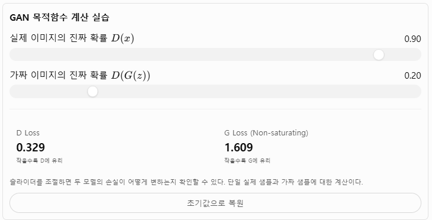


### (8) GAN의 이상적인 균형 상태

이론적으로 실제 데이터 분포와 생성 데이터 분포가 같아지고 최적 판별자가 이를 구별할 수 없다면 다음과 같다.

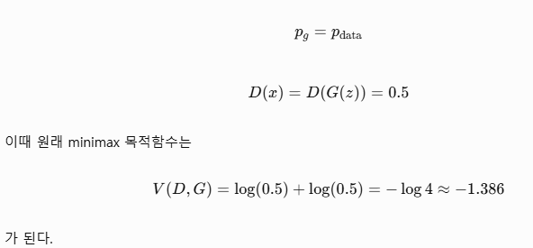

다만 실제 학습에서 손실값이 이 숫자에 가까워진다고 해서 반드시 생성 이미지가 우수하거나 Mode Collapse가 없다고 결론 내릴 수는 없다.

최종 정리

GAN의 목적함수는 두 모델이 서로 반대되는 목표를 추구하는 경쟁 학습을 나타낸다.

- Discriminator는 (D(x) -> 1, (D(G(z))) -> 0을 목표로 한다.
- Generator는 (D(G(z)) -> 1 을 목표로 한다.
- PyTorch에서는 목적함수를 손실 최소화 형태로 변환하여 학습한다.
- 앞서 작성한 코드는 Discriminator에는 BCE 손실을, Generator에는 Non-saturating BCE 손실을 적용한 표준적인 GAN 학습 방식이다.


## 4. GAN의 역사와 발전 과정 (2014\~2026)

GAN(Generative Adversarial Network, 생성적 적대 신경망)은 2014년 Ian Goodfellow 등이 제안한 생성형 딥러닝 모델이다. 두 신경망이 서로 경쟁하며 학습한다는 아이디어를 기반으로 이미지 생성, 이미지 변환, 초고해상도 생성, 데이터 증강 등의 분야에서 발전해 왔다.

GAN의 발전은 크게 기본 GAN → DCGAN → 조건부·안정화 GAN → 고품질 이미지 생성 GAN → StyleGAN → Diffusion 및 하이브리드 생성 모델이라는 흐름으로 이해할 수 있다.

### (1) GAN 발전 연대표

1. 2014 — GAN 등장

   Ian Goodfellow 등이 생성자(Generator)와 판별자(Discriminator)의 경쟁 학습 구조를 제안하였다. 생성 모델 연구의 중요한 전환점이 되었다.
2. 2014\~2015 — Conditional GAN, DCGAN

   조건부 생성으로 원하는 클래스의 데이터를 생성할 수 있게 되었으며, CNN을 적용한 DCGAN이 이미지 생성 구조를 발전시켰다.
3. 2016 — Pix2Pix의 기반 연구, InfoGAN

   이미지 간 변환과 잠재변수의 해석 가능성을 높이는 연구가 확장되었다. Pix2Pix 논문은 2016년 공개되어 2017년 발표되었다.
4. 2017 — WGAN, WGAN-GP, CycleGAN, Progressive GAN

   학습 불안정성과 Mode Collapse를 완화하는 기법이 발전하였다. 비짝지어진 이미지 변환과 점진적 고해상도 생성도 주목받았다.
5. 2018\~2019 — BigGAN, StyleGAN, StyleGAN2

   고품질 이미지 생성, 스타일 제어, 잠재공간 조작 기술이 크게 발전하였다.
6. 2020\~2021 — StyleGAN2-ADA, StyleGAN3

   소량 데이터 학습과 생성 이미지의 위치·회전 변화에 따른 일관성을 개선하였다.
7. 2022\~2026 — Diffusion 중심의 생성 모델 발전과 GAN의 전문화

   이미지 생성의 주요 연구 흐름이 Diffusion과 Transformer 기반 모델로 확대되었다. GAN은 실시간 이미지 생성, 영상 처리, 이미지 복원, 경량 생성 모델 등에서 계속 활용되고 있다.

### (2) 대표 GAN 모델 발전 비교

| 연도         | 모델              | 핵심 기술             | 주요 기여                |
| ---------- | --------------- | ----------------- | -------------------- |
| 2014       | GAN             | 적대적 학습            | 생성 모델의 기본 구조         |
| 2014       | CGAN            | 조건부 생성            | 클래스·조건 제어            |
| 2015       | DCGAN           | CNN 기반 생성·판별      | 이미지 생성 구조 개선         |
| 2016       | InfoGAN         | 상호정보량             | 잠재요인 해석              |
| 2017       | WGAN            | Wasserstein 거리    | 학습 안정성 개선            |
| 2017       | WGAN-GP         | Gradient Penalty  | Lipschitz 제약의 안정적 적용 |
| 2017       | Pix2Pix         | 조건부 이미지 변환        | 짝지어진 이미지 변환          |
| 2017       | CycleGAN        | Cycle Consistency | 비짝지어진 이미지 변환         |
| 2017       | Progressive GAN | 점진적 해상도 증가        | 고해상도 이미지 생성          |
| 2018       | BigGAN          | 대규모 조건부 GAN       | 고품질 클래스 조건부 생성       |
| 2018\~2019 | StyleGAN        | 스타일 기반 생성         | 이미지 속성 제어            |
| 2019\~2020 | StyleGAN2       | 구조 및 정규화 개선       | 생성 아티팩트 감소           |
| 2020       | StyleGAN2-ADA   | 적응형 데이터 증강        | 소량 데이터 학습            |
| 2021       | StyleGAN3       | Alias-free 생성     | 변환 일관성 개선            |

연도는 주로 최초 논문 공개 시점을 기준으로 하며, 학회 발표 연도와 다를 수 있다.

### (3) GAN이 해결해 온 핵심 문제

| 발전 단계           | 기존 문제                 | 해결 방향             |
| --------------- | --------------------- | ----------------- |
| 기본 GAN          | 학습 불안정, Mode Collapse | 적대적 학습 구조 연구      |
| DCGAN           | 이미지의 공간적 특징 활용 부족     | CNN 적용            |
| WGAN            | 손실 해석과 기울기 문제         | Wasserstein 거리 활용 |
| WGAN-GP         | 가중치 클리핑의 한계           | Gradient Penalty  |
| Progressive GAN | 고해상도 생성의 어려움          | 저해상도부터 점진적 학습     |
| StyleGAN        | 생성 이미지 속성 제어의 어려움     | 스타일 기반 생성 구조      |
| StyleGAN2-ADA   | 적은 학습 데이터에서 과적합       | 적응형 데이터 증강        |
| StyleGAN3       | 이미지 변환 시 아티팩트 발생      | Alias-free 설계     |

GAN의 연구 역사는 단순히 이미지를 더 선명하게 만드는 과정이 아니다. 학습 안정성, 생성 다양성, 조건 제어, 해상도, 추론 효율성을 지속적으로 개선해 온 과정이다.

### (4) 대표 모델별 이미지 생성 특징

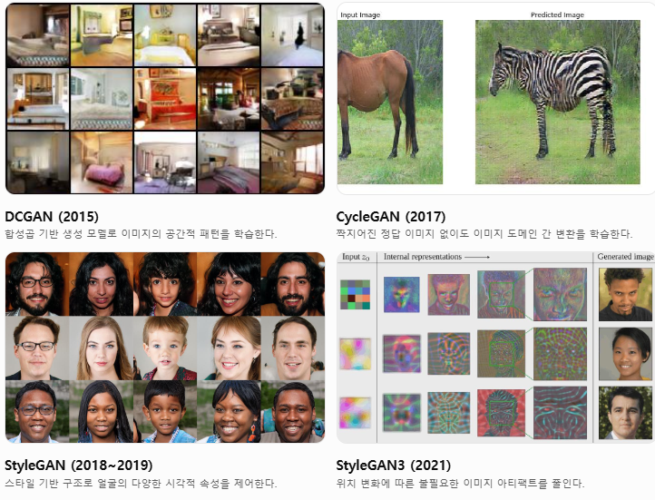

### (5) 2026년 관점에서 GAN의 위치

GAN이 Diffusion 모델로 완전히 대체된 것은 아니다. 최근에는 Diffusion 모델의 생성 품질과 GAN 계열의 적대적 학습을 결합하여 고품질 이미지를 적은 추론 단계로 생성하는 기술이 연구되고 있다.

대표적으로 2025년 ICCV의 SANA-Sprint 연구는 일관성 증류와 적대적 증류를 결합하여 1\~4단계 이미지 생성을 제안하였다.&#x20;

또한 ICML 2025 연구에서는 사전학습된 Diffusion 모델을 GAN 목적함수로 미세조정하여 단일 단계 생성기로 전환하는 접근법을 제시하였다.&#x20;

즉, 최신 발전 방향은 다음과 같이 정리할 수 있다.

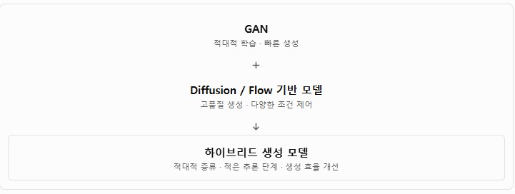

### (6) PyTorch 교육과정에 적용하는 학습 순서

| 단계 | 학습 모델     | 핵심 PyTorch 기술                     | 실습              |
| -- | --------- | --------------------------------- | --------------- |
| 1  | GAN       | `Linear`, `LeakyReLU`             | MNIST 숫자 생성     |
| 2  | DCGAN     | `Conv2d`, `ConvTranspose2d`       | CNN 기반 숫자 생성    |
| 3  | CGAN      | 조건 벡터, `Embedding`                | 원하는 숫자 생성       |
| 4  | WGAN-GP   | Gradient Penalty, Autograd        | 학습 안정성 비교       |
| 5  | Pix2Pix   | U-Net, PatchGAN                   | 이미지 변환          |
| 6  | CycleGAN  | Cycle Consistency Loss            | 이미지 스타일 변환      |
| 7  | StyleGAN  | Mapping Network, Style Modulation | 스타일 기반 생성 구조 분석 |
| 8  | Diffusion | 노이즈 예측, U-Net                     | GAN과 생성 품질 비교   |

앞서 구현한 MNIST GAN을 출발점으로 한다면, DCGAN → CGAN → WGAN-GP → Diffusion 순서로 실습하는 것이 효과적이다. 생성 구조의 발전, 조건부 생성, 학습 안정화, 최신 생성 패러다임을 단계적으로 연결할 수 있기 때문이다.

### (7) 주요 원문 논문

- [Goodfellow et al. (2014), Generative Adversarial Nets](https://papers.neurips.cc/paper_files/paper/2014/hash/f033ed80deb0234979a61f95710dbe25-Abstract.html)
- [Radford et al. (2015), DCGAN](https://arxiv.org/abs/1511.06434)
- [Arjovsky et al. (2017), Wasserstein GAN](https://arxiv.org/abs/1701.07875)
- [Zhu et al. (2017), CycleGAN](https://arxiv.org/abs/1703.10593)
- [Karras et al. (2018), StyleGAN](https://arxiv.org/abs/1812.04948)
- [Karras et al. (2021), StyleGAN3](https://arxiv.org/abs/2106.12423)

핵심 결론: GAN의 역사는 2014년 적대적 학습 개념의 등장으로 시작하여 CNN 기반 생성, 학습 안정화, 고해상도 생성, 스타일 제어 기술로 발전하였다. 2026년에는 GAN이 독립적인 생성 모델일 뿐 아니라 Diffusion·Flow 기반 생성 모델의 속도와 품질을 개선하는 학습 기법으로도 활용되고 있다.